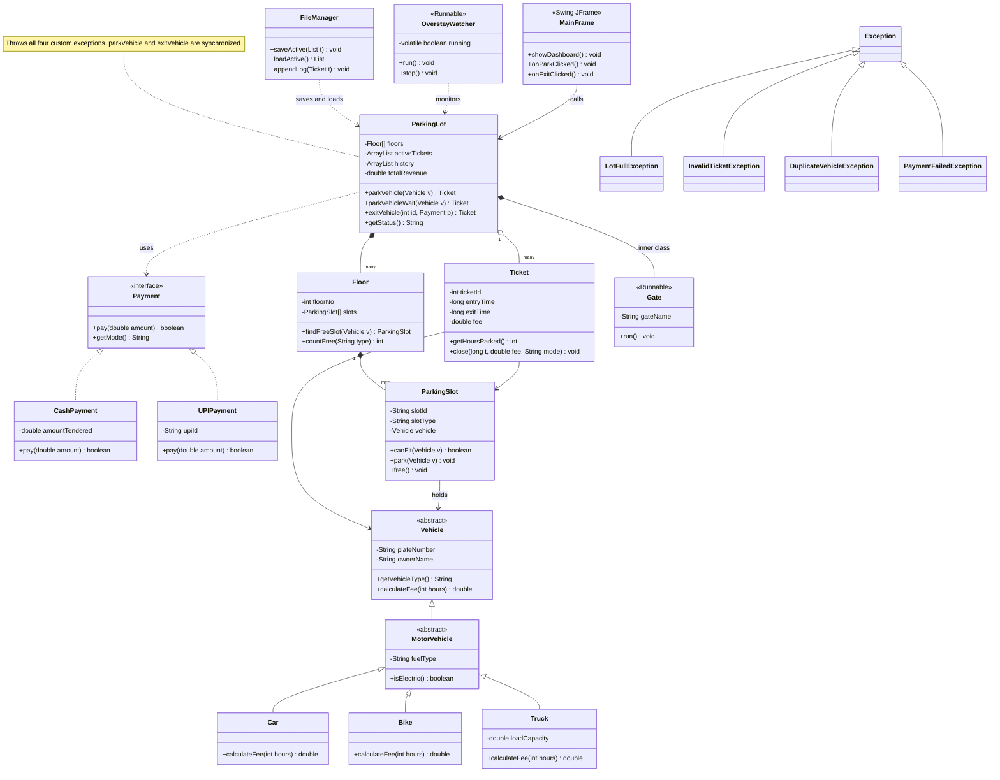
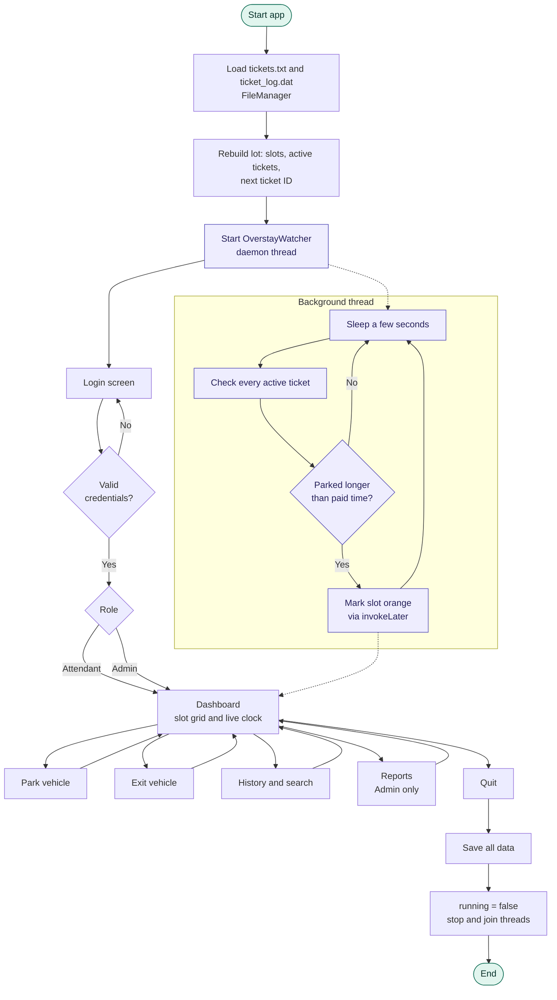
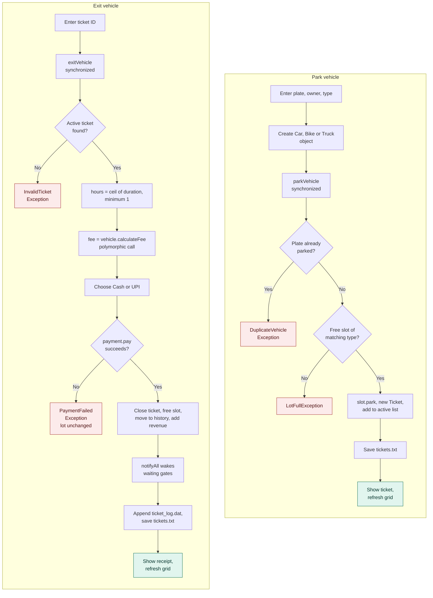

# 🚗 SmartPark: Object-Oriented Parking Management System

> **B.Tech 2nd Year OOP (Java) Project**  
> **Author**: Rohan Tanwani  
> **Repository**: [https://github.com/rohantanwani08/SmartPark.git](https://github.com/rohantanwani08/SmartPark.git)

---

## 📌 Project Overview
**SmartPark** is a robust, modular, multithreaded parking management system engineered in Java. It demonstrates core and advanced Object-Oriented Programming (OOP) concepts, featuring custom exception hierarchies, dynamic runtime polymorphism, thread-safe concurrent slot allocation, dual-mode file persistence (CSV & binary), and a decoupled Swing GUI dashboard.

---

## 🏛️ System Architecture & Diagrams

### 1. UML Class Diagram
The diagram below models the complete object-oriented structure: inheritance hierarchies, interface realization, compositions, and custom exceptions.



---

### 2. Overall Application Flow
Illustrates lifecycle execution: initialization, dual persistence reload, daemon thread startup, authentication, dashboard operations, and graceful shutdown.



---

### 3. Park and Exit Transaction Flow
Details transactional integrity: duplicate checks, slot allocation, fee calculation, payment collection before slot vacation, and inter-thread notifications.



---

## 🛠️ Build and Run Instructions

### Prerequisites
- JDK 17 or JDK 21+ (`javac -version`, `java -version`)
- Git

### Compile & Run from Terminal

#### PowerShell (Windows):
```powershell
# Compile all source files into out directory:
javac -d out (Get-ChildItem -Recurse src -Filter *.java | ForEach-Object { $_.FullName })

# Run the application:
java -cp out smartpark.Main
```

#### Bash (Linux/macOS):
```bash
# Compile:
javac -d out $(find src -name "*.java")

# Run:
java -cp out smartpark.Main
```
